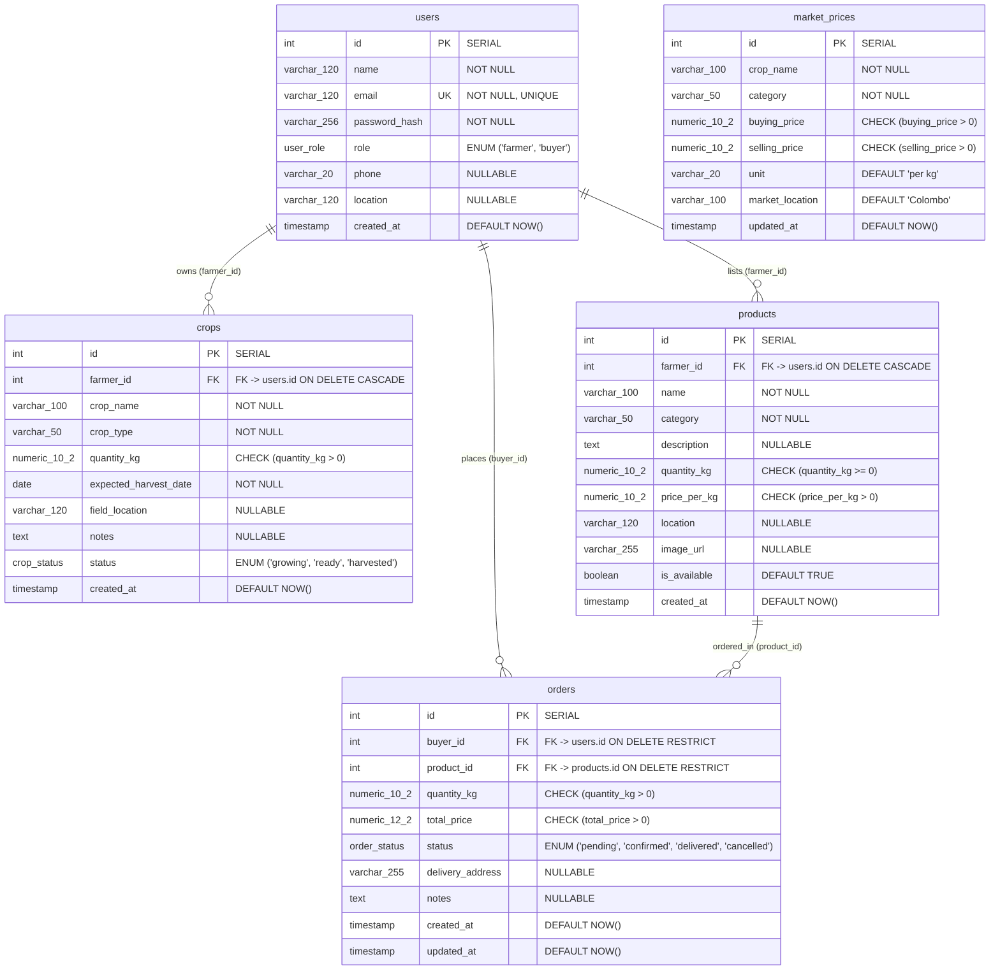

# AgroLink — Architectural Analysis & System Summary

**Author / Senior Software Architect Analysis**  
**Workspace:** `AgroLink`  
**Analysis Date:** October 2026  
**Status:** Incomplete MVP / Functional Prototype  

---

## 1. Project Overview

**AgroLink** is a direct-to-consumer and direct-to-business agricultural trading and farm management web platform tailored for the Sri Lankan agricultural market. The platform bridges the gap between local farmers and wholesale/retail buyers, eliminating exploitative middlemen and addressing market price opacity.

### Intended User Personas
1. **Farmers (`farmer`):**
   - Manage farm cultivation cycles with an internal crop tracking system (tracking crop name, crop type, quantity in kg, expected harvest dates, field locations, notes, and lifecycle status: `growing`, `ready`, `harvested`).
   - Create, update, and manage public marketplace listings with set prices per kilogram and available quantities.
   - Monitor incoming buyer orders, review buyer delivery details, and update order fulfillment statuses (`pending` → `confirmed` → `delivered` or `cancelled`).
   - Compare farm pricing against benchmark market prices in Colombo.
2. **Buyers (`buyer`):**
   - Search, filter, and inspect agricultural produce listings by category (Vegetables, Fruits, Grains & Rice, Spices, Pulses, Roots & Tubers).
   - View market reference prices (buying vs. selling prices and dealer margins) to identify competitive deals.
   - Place direct purchase orders specifying desired kilogram quantities and delivery addresses.
   - Track order statuses, view order history, and initiate contact with farmers directly via WhatsApp and direct telephone dialing.
3. **Suppliers / Intermediaries:**
   - *Not implemented.* Although mentioned in standard marketplace taxonomies, the database schema (`user_role` ENUM) and registration flow restrict user accounts strictly to `farmer` or `buyer`.
4. **Platform Administrators (`admin`):**
   - *Not implemented.* There is no administrative panel, no admin role in the database enum, and no moderation tooling for dispute resolution, user banning, or price table curation.

> **Context Evidence:** As documented in [`templates/base.html`](file:///c:/Users/anush/OneDrive/Desktop/Projects%20for%20money/AgroLink/templates/base.html#L144-148), this project was developed as an undergraduate academic/capstone project affiliated with *Kingston University London* and *Esoft Campus Sri Lanka* (authored by S E Coulton, Esoft ID: 131044).

---

## 2. Project Ambition / Vision

### What the Code Demonstrates (Facts from Source Code)
- **Elimination of Intermediaries:** Allows buyers to place orders directly with farmers without commissions or intermediary escrow handling ([`blueprints/orders/routes.py`](file:///c:/Users/anush/OneDrive/Desktop/Projects%20for%20money/AgroLink/blueprints/orders/routes.py#L21-62)).
- **Price Benchmarking:** Features a dedicated reference price database (`market_prices` table) containing benchmark buying and selling rates across Sri Lankan markets (seeded with Colombo wholesale/retail rates in [`blueprints/prices/routes.py:L8-42`](file:///c:/Users/anush/OneDrive/Desktop/Projects%20for%20money/AgroLink/blueprints/prices/routes.py#L8-42)).
- **Direct Communication:** Features instant communication triggers via WhatsApp deep links (`https://wa.me/<phone>`) and cellular tel links (`tel:<phone>`) in [`templates/marketplace/index.html`](file:///c:/Users/anush/OneDrive/Desktop/Projects%20for%20money/AgroLink/templates/marketplace/index.html#L135-L148).
- **Dual Operations (Private Farming vs. Public Marketplace):** Separates private crop development records (`crops` table) from public saleable inventory (`products` table).

### What We Infer (Architectural Vision)
- **National Agricultural Hub:** The ambition was to build a unified digital agricultural exchange for Sri Lanka, empowering farmers with real-time price intelligence and harvest forecasting.
- **Dynamic Bidding Market (Unfulfilled):** The route [`/bids`](file:///c:/Users/anush/OneDrive/Desktop/Projects%20for%20money/AgroLink/blueprints/prices/routes.py#L113) and template [`templates/prices/bids.html`](file:///c:/Users/anush/OneDrive/Desktop/Projects%20for%20money/AgroLink/templates/prices/bids.html#L9) title the screen *"Live Farmer Bidding Market"*. However, the code reveals that this was an aspirational feature or placeholder: the "Place Bid" button simply links to the standard fixed-price buy-now order form.
- **Automated Price Recommender (Unconnected):** A helper function `get_price_suggestion(product_name)` exists in [`blueprints/prices/routes.py:L99-111`](file:///c:/Users/anush/OneDrive/Desktop/Projects%20for%20money/AgroLink/blueprints/prices/routes.py#L99-111) to calculate recommended midpoint listing prices based on market spreads, indicating an intent to assist farmers when setting fair product prices.

---

## 3. Tech Stack

### Language Breakdown (Approximate % of Codebase)
*Analysis based on 3,493 total source lines across the repository (excluding `venv/`, `.git/`, and `__pycache__/`):*
- **HTML (Jinja2 Templates):** ~1,602 lines (**45.9%**)
- **SQL (Schema DDL & Seed Data):** ~945 lines (**27.1%**)
- **Python (Flask Backend & Models):** ~709 lines (**20.3%**)
- **Markdown (Documentation):** ~210 lines (**6.0%**)
- **Config & Environment Files:** ~27 lines (**0.8%**)

```
Language Distribution:
┌─────────────────────────────────┬──────────┬───────────┐
│ Language / File Type            │ Lines    │ Share     │
├─────────────────────────────────┼──────────┼───────────┤
│ HTML / Jinja2 (.html)           │ 1,602    │ 45.9%     │
│ SQL (.sql)                      │ 945      │ 27.1%     │
│ Python (.py)                    │ 709      │ 20.3%     │
│ Markdown (.md)                  │ 210      │ 6.0%      │
│ Configs (.env, requirements)    │ 27       │ 0.8%      │
└─────────────────────────────────┴──────────┴───────────┘
```

### Frameworks, Libraries, and Versions
*Extracted from [`requirements.txt`](file:///c:/Users/anush/OneDrive/Desktop/Projects%20for%20money/AgroLink/requirements.txt) and runtime verification:*
- **Backend Core:** `Flask == 3.0.0`
- **ORM / Database Layer:** `Flask-SQLAlchemy == 3.1.1` (built on `SQLAlchemy >= 2.0`)
- **Authentication Session Manager:** `Flask-Login == 0.6.3`
- **Form Handling:** `Flask-WTF == 1.2.1` and `WTForms == 3.1.1` (*Declared in requirements, but unused in application code; forms use raw HTML and `request.form`*)
- **Database Drivers:** `psycopg2-binary == 2.9.9` and `psycopg[binary] >= 3.1.18`
- **Environment Management:** `python-dotenv == 1.0.0`
- **Security & Cryptography:** `Werkzeug == 3.0.1` (`generate_password_hash`, `check_password_hash` using `scrypt`)
- **Validation:** `email-validator == 2.1.0` (*Present in requirements, but unused in auth routes*)
- **Frontend / Styling:** 
  - Vanilla HTML5 + Jinja2 templating
  - Tailwind CSS via CDN script (`https://cdn.tailwindcss.com`) with custom theme extensions defined in [`templates/base.html:L9-26`](file:///c:/Users/anush/OneDrive/Desktop/Projects%20for%20money/AgroLink/templates/base.html#L9-26)
  - Google Fonts (`Playfair Display`, `DM Sans`)
- **Database Engine:** PostgreSQL 14+ (active local instance: PostgreSQL 18 / dump from PostgreSQL 16.2)
- **Hosting & Deployment:**
  - Local development server running through Werkzeug (`python app.py`)
  - No containerization (`Dockerfile` / `docker-compose.yml` absent)
  - No cloud configuration (no Heroku, AWS, or GCP manifest files)
- **Third-Party Services & External APIs:**
  - **Unsplash CDN:** Hardcoded image category dictionary used for product thumbnails ([`blueprints/marketplace/routes.py:L10-18`](file:///c:/Users/anush/OneDrive/Desktop/Projects%20for%20money/AgroLink/blueprints/marketplace/routes.py#L10-18))
  - **WhatsApp API:** `https://wa.me/<phone>` click-to-chat links
  - **No external payment gateways** (e.g., Stripe, PayHere) are integrated

---

## 4. Architecture

### Architectural Pattern
AgroLink is implemented as a **Modular Monolithic MVC (Model-View-Controller)** web application using Flask's **Application Factory** pattern and **Blueprints**.

```mermaid
graph TD
    subgraph Client["Client Tier"]
        Browser["Web Browser (HTML5, Tailwind CDN, JS)"]
    end

    subgraph Server["Flask Application Server (MVC Monolith)"]
        AppInit["app.py (create_app factory)"]
        Extensions["extensions.py (db, login_manager)"]
        
        subgraph Controllers["Controllers (Flask Blueprints)"]
            AuthBP["auth_bp (/auth)"]
            DashBP["dashboard_bp (/dashboard)"]
            MarketBP["marketplace_bp (/marketplace)"]
            OrdersBP["orders_bp (/orders)"]
            PricesBP["prices_bp (/)"]
            MainBP["main_bp (/) - SHADOWED"]
        end

        subgraph ModelsLayer["Model Tier (SQLAlchemy ORM)"]
            UserModel["User (users)"]
            CropModel["Crop (crops)"]
            ProductModel["Product (products)"]
            OrderModel["Order (orders)"]
            PriceModel["MarketPrice (market_prices)"]
        end

        subgraph ViewLayer["View Tier (Jinja2 Templates)"]
            Templates["templates/*.html & base.html"]
        end
    end

    subgraph DataTier["Data Tier"]
        PG[("PostgreSQL Database (agrolink_db)")]
    end

    subgraph ExternalServices["External Services"]
        Unsplash["Unsplash Image CDN"]
        WhatsApp["WhatsApp Web API"]
    end

    Browser <-->|HTTP GET/POST (Cookie Sessions)| Controllers
    Controllers --> ViewLayer
    ViewLayer --> Browser
    Controllers <--> ModelsLayer
    ModelsLayer <--> Extensions
    Extensions <-->|SQL Queries / psycopg2| PG
    ViewLayer -.->|Image URLs| Unsplash
    Browser -.->|Click-to-Chat| WhatsApp
```

### Folder Structure
```text
AgroLink/
├── .env                              # Environment variable configuration (contains active DB credentials)
├── .env.example                      # Template for required environment variables
├── .gitignore                        # Git exclusion rules (.env, venv, *.sql, __pycache__)
├── README.md                         # Comprehensive project documentation & run instructions
├── requirements.txt                  # Python dependency list
├── app.py                            # Application factory, extension attachment, blueprint registration
├── extensions.py                     # Instantiation of SQLAlchemy db and LoginManager
├── models.py                         # Declarative SQLAlchemy models (User, Crop, Product, Order, MarketPrice)
├── agrolink_database_backup_file.sql # Baseline SQL dump with schema, constraints, and initial records
├── backup/                           # Newly generated backup folder (Schema, SQL dump, JSON data)
│   ├── schema.sql                    # PostgreSQL DDL schema export
│   ├── database_dump.sql             # Full database SQL dump (schema + live data)
│   └── data_backup.json              # Structured JSON dump of all 5 tables
├── blueprints/                       # Route controllers partitioned by domain
│   ├── auth/routes.py                # Login, registration, logout, session management
│   ├── dashboard/routes.py           # Farmer dashboard, Buyer dashboard, Crop CRUD
│   ├── marketplace/routes.py         # Product listing, search, category filter, edit/delete
│   ├── orders/routes.py              # Order placement, status transitions, order cancellation
│   ├── prices/routes.py              # Market benchmark prices, deals, seed helper, bids page
│   └── main/routes.py                # Healthcheck endpoint (shadowed by prices_bp)
└── templates/                        # Server-rendered Jinja2 HTML templates
    ├── base.html                     # Global layout, Tailwind config, navigation, alerts, footer
    ├── auth/                         # login.html, register.html
    ├── dashboard/                    # farmer.html, buyer.html, crops.html, crop_form.html
    ├── marketplace/                  # index.html, product_detail.html, product_form.html
    ├── orders/                       # index.html, order_detail.html, place_order.html
    └── prices/                       # index.html, bids.html
```

### Frontend, Backend, and Database Communication Flow
1. **Frontend to Backend:** Synchronous HTTP GET and POST requests triggered by standard browser form submissions and hyperlink navigations. Jinja2 templates render HTML entirely server-side; dynamic client interactions (e.g., category filtering on the prices page) use lightweight vanilla JavaScript.
2. **Backend to Database:** Controllers interface with PostgreSQL via SQLAlchemy ORM sessions (`db.session.add`, `db.session.commit`, `Model.query.filter_by(...)`).
3. **Authentication & Authorization Flow:**
   - Client submits credentials to `/auth/login`.
   - Backend queries `User` table, verifies hash via `werkzeug.security.check_password_hash`.
   - On success, `flask_login.login_user` creates an encrypted session cookie stored in the client's browser.
   - Protected endpoints enforce `@login_required`.
   - Role-based authorization is enforced imperatively inside route functions (e.g., `if current_user.role != 'farmer': flash(...); return redirect(...)`).

---

## 5. Database Design

The PostgreSQL database (`agrolink_db`) consists of **5 relational tables** utilizing custom PostgreSQL ENUM types, sequence-backed primary keys, and foreign key constraints.

### Entity-Relationship Diagram (Mermaid)



### Table Breakdown & Live Row Counts
Data verified from active PostgreSQL instance (`agrolink_db` on `localhost:5432`):

| Table Name | Description | Key Columns / Constraints | Indexes | Live Row Count | Real Data vs Empty |
| :--- | :--- | :--- | :--- | :--- | :--- |
| `users` | All registered user accounts | `id` (PK), `email` (UK), `role` (`user_role`), `password_hash` | `users_pkey`, `users_email_key`, `idx_users_email`, `idx_users_role` | **10** | Real accounts (6 Farmers, 4 Buyers) |
| `crops` | Farmer private cultivation tracking | `id` (PK), `farmer_id` (FK → `users.id`), `status` (`crop_status`) | `crops_pkey`, `idx_crops_farmer_id`, `idx_crops_status` | **6** | Real crop records across Kandy & Matale |
| `products` | Public marketplace listings | `id` (PK), `farmer_id` (FK → `users.id`), `is_available` | `products_pkey`, `idx_products_farmer_id`, `idx_products_category`, `idx_products_is_available` | **5** | Real product listings |
| `orders` | Buyer purchase transactions | `id` (PK), `buyer_id` (FK → `users`), `product_id` (FK → `products`), `status` (`order_status`) | `orders_pkey`, `idx_orders_buyer_id`, `idx_orders_product_id`, `idx_orders_status` | **6** | Real orders placed by buyers |
| `market_prices`| Benchmark market rates | `id` (PK), `crop_name`, `category`, `buying_price`, `selling_price` | `market_prices_pkey`, `idx_market_prices_category`, `idx_market_prices_crop` | **25** | Complete benchmark dataset for Sri Lanka |

- **Orphaned / Unused Tables:** None. All 5 tables are mapped to active ORM models in [`models.py`](file:///c:/Users/anush/OneDrive/Desktop/Projects%20for%20money/AgroLink/models.py) and referenced in controllers.
- **Triggers:**
  - `trg_orders_updated_at`: Automatically sets `updated_at = NOW()` on order modifications.
  - `trg_market_prices_updated_at`: Automatically sets `updated_at = NOW()` on market price updates.
- **Backup Locations:**
  - Full Schema DDL: [`backup/schema.sql`](file:///c:/Users/anush/OneDrive/Desktop/Projects%20for%20money/AgroLink/backup/schema.sql)
  - Full Database SQL Dump (DDL + Data): [`backup/database_dump.sql`](file:///c:/Users/anush/OneDrive/Desktop/Projects%20for%20money/AgroLink/backup/database_dump.sql)
  - Table-by-Table JSON Backup: [`backup/data_backup.json`](file:///c:/Users/anush/OneDrive/Desktop/Projects%20for%20money/AgroLink/backup/data_backup.json)
  - Historical repository dump: [`agrolink_database_backup_file.sql`](file:///c:/Users/anush/OneDrive/Desktop/Projects%20for%20money/AgroLink/agrolink_database_backup_file.sql)

---

## 6. Feature Status Table

| Feature / Module | Status | Evidence (File Paths) | Notes |
| :--- | :---: | :--- | :--- |
| **User Registration** | ✅ Working | [`blueprints/auth/routes.py:L9-42`](file:///c:/Users/anush/OneDrive/Desktop/Projects%20for%20money/AgroLink/blueprints/auth/routes.py#L9-42)<br>[`templates/auth/register.html`](file:///c:/Users/anush/OneDrive/Desktop/Projects%20for%20money/AgroLink/templates/auth/register.html) | Registers `farmer` or `buyer` accounts with email, hashed password, phone, location. |
| **Authentication / Login / Logout** | ✅ Working | [`blueprints/auth/routes.py:L45-68`](file:///c:/Users/anush/OneDrive/Desktop/Projects%20for%20money/AgroLink/blueprints/auth/routes.py#L45-68)<br>[`templates/auth/login.html`](file:///c:/Users/anush/OneDrive/Desktop/Projects%20for%20money/AgroLink/templates/auth/login.html) | Session cookie-based authentication via Flask-Login. Passwords verified via `scrypt`. |
| **Role-based Redirection & Authorization** | 🟡 Partial | [`blueprints/dashboard/routes.py:L10-30`](file:///c:/Users/anush/OneDrive/Desktop/Projects%20for%20money/AgroLink/blueprints/dashboard/routes.py#L10-30) | Directs farmers to farmer dashboard and buyers to buyer dashboard. Enforced procedurally, but lacks reusable role-guard decorators. |
| **Farmer Crop Tracking (CRUD)** | ✅ Working | [`blueprints/dashboard/routes.py:L34-108`](file:///c:/Users/anush/OneDrive/Desktop/Projects%20for%20money/AgroLink/blueprints/dashboard/routes.py#L34-108)<br>[`templates/dashboard/crops.html`](file:///c:/Users/anush/OneDrive/Desktop/Projects%20for%20money/AgroLink/templates/dashboard/crops.html) | Complete lifecycle management (add, edit, view, delete crops). |
| **Marketplace Listings (Farmer CRUD)** | ✅ Working | [`blueprints/marketplace/routes.py:L58-120`](file:///c:/Users/anush/OneDrive/Desktop/Projects%20for%20money/AgroLink/blueprints/marketplace/routes.py#L58-120)<br>[`templates/marketplace/product_form.html`](file:///c:/Users/anush/OneDrive/Desktop/Projects%20for%20money/AgroLink/templates/marketplace/product_form.html) | Allows farmers to create, edit, and soft-delete listings. |
| **Marketplace Catalog & Search** | ✅ Working | [`blueprints/marketplace/routes.py:L21-44`](file:///c:/Users/anush/OneDrive/Desktop/Projects%20for%20money/AgroLink/blueprints/marketplace/routes.py#L21-44)<br>[`templates/marketplace/index.html`](file:///c:/Users/anush/OneDrive/Desktop/Projects%20for%20money/AgroLink/templates/marketplace/index.html) | Category filtering and name substring search (`ilike`). Sorted by lowest price first. |
| **Order Placement** | ✅ Working | [`blueprints/orders/routes.py:L21-62`](file:///c:/Users/anush/OneDrive/Desktop/Projects%20for%20money/AgroLink/blueprints/orders/routes.py#L21-62)<br>[`templates/orders/place_order.html`](file:///c:/Users/anush/OneDrive/Desktop/Projects%20for%20money/AgroLink/templates/orders/place_order.html) | Validates stock, calculates total price, decrements stock in `products`, creates order. |
| **Order Status Workflow** | ✅ Working | [`blueprints/orders/routes.py:L64-104`](file:///c:/Users/anush/OneDrive/Desktop/Projects%20for%20money/AgroLink/blueprints/orders/routes.py#L64-104)<br>[`templates/orders/order_detail.html`](file:///c:/Users/anush/OneDrive/Desktop/Projects%20for%20money/AgroLink/templates/orders/order_detail.html) | Farmer can change status (`pending`, `confirmed`, `delivered`, `cancelled`). Buyer can cancel pending orders (which restores product stock). |
| **Market Prices Page** | ⚠️ Broken | [`blueprints/prices/routes.py:L45-97`](file:///c:/Users/anush/OneDrive/Desktop/Projects%20for%20money/AgroLink/blueprints/prices/routes.py#L45-97)<br>[`templates/prices/index.html:L34-58`](file:///c:/Users/anush/OneDrive/Desktop/Projects%20for%20money/AgroLink/templates/prices/index.html#L34-58) | Template key mismatch (`deal.product.name` vs `product_name`) and `seller_map` key mismatch causes broken lookups and negative savings calculations. |
| **Bidding System ("Live Farmer Bids")** | ❌ Not implemented | [`blueprints/prices/routes.py:L113-139`](file:///c:/Users/anush/OneDrive/Desktop/Projects%20for%20money/AgroLink/blueprints/prices/routes.py#L113-139)<br>[`templates/prices/bids.html:L97-100`](file:///c:/Users/anush/OneDrive/Desktop/Projects%20for%20money/AgroLink/templates/prices/bids.html#L97-100) | UI claims "Live Farmer Bidding Market", but button is "Place Bid" linking directly to the standard buy-now order form. No bidding logic exists. |
| **Payment Gateway Integration** | ❌ Not implemented | N/A | No checkout mechanism, no payment provider (Stripe, PayHere, COD tracking). Only nominal totals are calculated. |
| **In-App Chat / Messaging** | ❌ Not implemented | [`templates/marketplace/index.html:L135-147`](file:///c:/Users/anush/OneDrive/Desktop/Projects%20for%20money/AgroLink/templates/marketplace/index.html#L135-147) | No internal communication system. Replaced with external WhatsApp and phone dialer links. |
| **Product Image Uploads** | ✅ Working | [`blueprints/marketplace/routes.py`](file:///c:/Users/anush/OneDrive/Desktop/Projects%20for%20money/AgroLink/blueprints/marketplace/routes.py)<br>[`utils/uploads.py`](file:///c:/Users/anush/OneDrive/Desktop/Projects%20for%20money/AgroLink/utils/uploads.py) | Pillow thumbnail generation, validation (5MB max, format restrictions), custom image upload with stock fallback. |
| **User Profile Management** | ✅ Working | [`blueprints/profile/routes.py`](file:///c:/Users/anush/OneDrive/Desktop/Projects%20for%20money/AgroLink/blueprints/profile/routes.py)<br>[`templates/profile/edit.html`](file:///c:/Users/anush/OneDrive/Desktop/Projects%20for%20money/AgroLink/templates/profile/edit.html) | Profile editing (name, phone, whatsapp, bio, farm name, location picker, password update). |
| **Location Picker (Interactive Map)** | ✅ Working | [`static/js/location-picker.js`](file:///c:/Users/anush/OneDrive/Desktop/Projects%20for%20money/AgroLink/static/js/location-picker.js)<br>[`templates/partials/location_picker.html`](file:///c:/Users/anush/OneDrive/Desktop/Projects%20for%20money/AgroLink/templates/partials/location_picker.html)<br>[`blueprints/auth/routes.py`](file:///c:/Users/anush/OneDrive/Desktop/Projects%20for%20money/AgroLink/blueprints/auth/routes.py)<br>[`blueprints/profile/routes.py`](file:///c:/Users/anush/OneDrive/Desktop/Projects%20for%20money/AgroLink/blueprints/profile/routes.py) | Places API (New) autocomplete scoped to Sri Lanka (`lk`), draggable `AdvancedMarkerElement`, GPS button, reverse geocoding, manual coordinate fallback. |
| **Farmer Location Updates** | ✅ Working | [`blueprints/dashboard/routes.py`](file:///c:/Users/anush/OneDrive/Desktop/Projects%20for%20money/AgroLink/blueprints/dashboard/routes.py)<br>[`templates/dashboard/farmer.html`](file:///c:/Users/anush/OneDrive/Desktop/Projects%20for%20money/AgroLink/templates/dashboard/farmer.html) | One-click GPS update button in farmer dashboard, Sri Lanka bounding box validation, `location_updated_at` persistence, relative time indicator, CSRF & farmer-role guarded. |
| **Distance & Nearest First Sort** | ✅ Working | [`utils/geo.py`](file:///c:/Users/anush/OneDrive/Desktop/Projects%20for%20money/AgroLink/utils/geo.py)<br>[`blueprints/marketplace/routes.py`](file:///c:/Users/anush/OneDrive/Desktop/Projects%20for%20money/AgroLink/blueprints/marketplace/routes.py)<br>[`templates/components/cards.html`](file:///c:/Users/anush/OneDrive/Desktop/Projects%20for%20money/AgroLink/templates/components/cards.html)<br>[`templates/marketplace/index.html`](file:///c:/Users/anush/OneDrive/Desktop/Projects%20for%20money/AgroLink/templates/marketplace/index.html) | Server-side single-pass Haversine distance computation without external API calls. "approx. X km away" badges, "Nearest First" marketplace sorting (unpinned last), zero coordinates exposed to guests. |
| **Admin Panel / Moderation** | ❌ Not implemented | N/A | No admin authentication, no administrative dashboard, no user/listing moderation tools. |
| **Automated Notifications / Alerts** | ❌ Not implemented | N/A | Only transient Flask session flash messages on user redirects. No email or SMS notifications. |

---

## 7. What Is Missing / Incomplete

### 1. Dead Routes & Blueprint Conflicts
- **Shadowed Route Conflict:** [`blueprints/prices/routes.py:L5`](file:///c:/Users/anush/OneDrive/Desktop/Projects%20for%20money/AgroLink/blueprints/prices/routes.py#L5) sets `prices_bp = Blueprint('prices', __name__, url_prefix='/')`. In [`app.py:L40-41`](file:///c:/Users/anush/OneDrive/Desktop/Projects%20for%20money/AgroLink/app.py#L40-41), `prices_bp` is registered *before* `main_bp`. Because both define `@bp.route('/')`, Flask always matches `prices.index`. The root API route in [`blueprints/main/routes.py:L5-7`](file:///c:/Users/anush/OneDrive/Desktop/Projects%20for%20money/AgroLink/blueprints/main/routes.py#L5-7) (`return "AgroLink API is running 🚀"`) is completely unreachable. Furthermore, the live prices page is mounted at `/` instead of `/prices/` as documented in `README.md`.
- **Uncalled / Dead Function:** `get_price_suggestion(product_name)` in [`blueprints/prices/routes.py:L99-111`](file:///c:/Users/anush/OneDrive/Desktop/Projects%20for%20money/AgroLink/blueprints/prices/routes.py#L99-111) computes price recommendations, but is never invoked by any route or rendered into any view.

### 2. Frontend Bugs & Broken Contexts
- **Prices Template Dictionary Key Mismatch ([`templates/prices/index.html`](file:///c:/Users/anush/OneDrive/Desktop/Projects%20for%20money/AgroLink/templates/prices/index.html#L34-58)):**
  The route [`blueprints/prices/routes.py`](file:///c:/Users/anush/OneDrive/Desktop/Projects%20for%20money/AgroLink/blueprints/prices/routes.py#L79-87) constructs `best_deals` with keys `product_name`, `category`, `seller`, `price`, `market_price`, `saving`, and `product_id`. However, `templates/prices/index.html` attempts to read `deal.product.name`, `deal.product.category`, `deal.farmer_price`, and `product_id=deal.product.id`. Because `deal.product` is undefined, this block renders empty or invalid links.
- **Cheapest Sellers Grouping Bug ([`templates/prices/index.html:L172-215`](file:///c:/Users/anush/OneDrive/Desktop/Projects%20for%20money/AgroLink/templates/prices/index.html#L172-215)):**
  In `blueprints/prices/routes.py:L58-63`, `seller_map` is grouped by *product name* (`key = product.name.lower()`), but `templates/prices/index.html` iterates over it as `` and tries to look up `grouped[cat]`. Since `cat` is a product name (e.g. `fresh tomatoes`) and not a category, `grouped[cat]` returns `None`, calculating a fallback market price of `0` and displaying incorrect negative savings.
- **HTML Specification Violation ([`templates/marketplace/index.html:L83,135,143`](file:///c:/Users/anush/OneDrive/Desktop/Projects%20for%20money/AgroLink/templates/marketplace/index.html#L83)):**
  The entire product card is wrapped inside an `<a>` tag (`<a href="{{ url_for('marketplace.product_detail', ...) }}">`), but inside the card, there are nested `<a>` tags for WhatsApp and Call links. Nested anchors violate the HTML5 standard and cause erratic click-bubbling behavior in modern browsers.

### 3. Missing Structural Components
- **Missing CSRF Protection:** Flask-WTF is installed, but `CSRFProtect` is never initialized in `app.py`, and no template forms include CSRF tokens. All POST routes are vulnerable to Cross-Site Request Forgery.
- **Missing File Upload Infrastructure:** There is no file upload handler, no local upload folder, and no cloud storage adapter (e.g., AWS S3).
- **Missing Database Migrations:** No Alembic or Flask-Migrate configuration exists. Schema modifications currently require manual SQL scripting.
- **Zero Test Coverage:** No tests directory, no unit tests, and no integration tests exist.

---

## 8. Setup and Run Instructions

These instructions were verified directly against the running workspace environment on Windows PowerShell.

### 1. Prerequisites
- **Python 3.10+** (verified running Python 3.11/3.12)
- **PostgreSQL 14+** (running locally on port 5432)

### 2. Environment Setup
```powershell
# Open terminal in project root
cd "c:\Users\anush\OneDrive\Desktop\Projects for money\AgroLink"

# Create virtual environment (if not already created)
python -m venv venv

# Activate virtual environment
.\venv\Scripts\Activate.ps1
# If blocked by script policy:
# Set-ExecutionPolicy -Scope Process -ExecutionPolicy Bypass

# Install dependencies
pip install -r requirements.txt
```

### 3. Database Restoration
You can restore the database using the freshly generated backup or the baseline dump:
```powershell
# Create agrolink_db if not already present
createdb -U postgres agrolink_db

# Restore using the full backup
psql -U postgres -d agrolink_db -f "backup\database_dump.sql"
```

### 4. Configure `.env`
Ensure `.env` exists in the project root with the following keys (sample values):
```ini
FLASK_APP=app.py
FLASK_ENV=development
SECRET_KEY=<your-secret-key>
DATABASE_URL=postgresql://<db_user>:<db_password>@localhost:5432/agrolink_db
```
*(No secrets are printed here; ensure credentials match your local PostgreSQL server configuration).*

### 5. Run the Application
```powershell
python app.py
```
Open your browser at `http://127.0.0.1:5000/`.

### Verification Status
- Application successfully booted on local port `5000`.
- Database connectivity confirmed with 5 populated tables.
- Demo accounts verified:
  - Farmer: `nimal@agrolink.lk` / `password123`
  - Farmer: `sunil@agrolink.lk` / `password123`
  - Buyer: `kamani@agrolink.lk` / `password123`

---

## 9. Current Project Health

```
Project Health Scorecard:
┌───────────────────────────┬────────┬──────────────────────────────────────────────────────┐
│ Metric                    │ Score  │ Summary Assessment                                   │
├───────────────────────────┼────────┼──────────────────────────────────────────────────────┤
│ Code Structure & Layout   │ 7 / 10 │ Clean blueprint separation and modular models.       │
│ UI & Visual Polish        │ 8 / 10 │ Modern Tailwind aesthetic, clean cards and badges.   │
│ Documentation             │ 7 / 10 │ README is clear on setup, but lacks API/system docs. │
│ Bug Resilience            │ 4 / 10 │ Template mismatches on prices; shadowed root routes. │
│ Security Basics           │ 3 / 10 │ No CSRF protection; secrets in repo; no rate limit.  │
│ Test Coverage             │ 0 / 10 │ 0% test coverage; no test suite or CI pipelines.    │
│ Overall Health            │ 4.8/10 │ Functional Academic MVP / Incomplete for Production  │
└───────────────────────────┴────────┴──────────────────────────────────────────────────────┘
```

### Security Basics
- **Strengths:** Passwords securely hashed with `scrypt` via Werkzeug. Queries utilize SQLAlchemy ORM with bound parameters, guarding against standard SQL injection.
- **Weaknesses:**
  - **No CSRF Tokens:** Forms accept raw POST requests without token verification.
  - **Inventory Race Conditions:** Stock reduction in [`blueprints/orders/routes.py:L53`](file:///c:/Users/anush/OneDrive/Desktop/Projects%20for%20money/AgroLink/blueprints/orders/routes.py#L53) performs an in-memory subtraction without database row locking (`with_for_update()`), creating a race condition if two buyers purchase the same produce concurrently.
  - **Insecure Default Secret Key:** Fallback key `'dev-fallback-key'` used if `SECRET_KEY` is not set.

---

## 10. Recommended Next Steps

A prioritized roadmap to stabilize and complete AgroLink for production:

```mermaid
gantt
    title AgroLink Development Roadmap
    dateFormat  X
    axisFormat  Day %d
    section Critical (P0)
    Fix Blueprint Route Collision     :active, 0, 1
    Fix Prices Template Bugs          :active, 1, 2
    Enable Flask-WTF CSRF Protection  :active, 2, 4
    Database Row Locking for Orders   :active, 4, 5
    section Important (P1)
    Migrate to Flask-Migrate (Alembic): 5, 7
    Implement User Profile Management : 7, 10
    Multipart Image Uploads (S3/Local): 10, 13
    Resolve Bidding vs Direct Buy     : 13, 15
    section Nice to Have (P2)
    Integrate Payment Gateway         : 15, 20
    Build Admin Moderation Panel      : 20, 24
    Automated Test Suite (pytest)     : 24, 28
    Dockerize Container Stack         : 28, 30
```



### Phase 1: Critical Stabilization (P0 — Immediate)
1. **Fix Blueprint Route Collision:**
   - In [`blueprints/prices/routes.py:L5`](file:///c:/Users/anush/OneDrive/Desktop/Projects%20for%20money/AgroLink/blueprints/prices/routes.py#L5), change `url_prefix='/'` to `url_prefix='/prices'`.
   - Update `prices_bp` route decorators so the price dashboard lives at `/prices/` and bids at `/prices/bids`.
   - Restore [`blueprints/main/routes.py`](file:///c:/Users/anush/OneDrive/Desktop/Projects%20for%20money/AgroLink/blueprints/main/routes.py) or convert it into a dedicated marketing landing page.
2. **Fix `templates/prices/index.html` Dictionary Key Mismatches:**
   - Align template variable references (`deal.product_name`, `deal.price`, `deal.product_id`) with dictionary keys produced in `blueprints/prices/routes.py`.
   - Fix `seller_map` grouping logic to group by category or update the template to iterate by product name.
   - Separate nested `<a>` tags in `templates/marketplace/index.html`.
3. **Enable Global CSRF Protection:**
   - Initialize `CSRFProtect(app)` from `Flask-WTF` in `app.py` and inject `{{ csrf_token() }}` into all HTML forms.
4. **Prevent Inventory Concurrency Glitches:**
   - Wrap order placement in an explicit transaction with `Product.query.filter_by(...).with_for_update()`.

### Phase 2: Important Enhancements (P1 — Next Milestone)
1. **Database Migrations:**
   - Integrate `Flask-Migrate` (`alembic`) to track incremental database schema updates without raw SQL dumps.
2. **Produce Image Uploads:**
   - Add image file upload support (`Flask-Uploads` or AWS S3 presigned URLs) to replace hardcoded Unsplash image defaults.
3. **User Profile & Account Management:**
   - Build a `/profile` route enabling farmers and buyers to update contact info, delivery addresses, and change passwords.
4. **Resolve Bidding Semantics:**
   - Decide whether to implement a true bidding/auction model with a new `bids` table, or rebrand `/bids` to "Lowest Price Highlights" to reflect actual functionality.

### Phase 3: Production Readiness & Nice-to-Have (P2)
1. **Payment Gateway Integration:**
   - Integrate PayHere (standard for Sri Lanka) or Stripe for credit card, debit card, and mobile wallet processing.
2. **Admin Dashboard:**
   - Add an `admin` role to `user_role` and build an admin portal for moderating users, resolving disputes, and editing official benchmark market prices.
3. **Automated Testing & CI/CD:**
   - Set up `pytest` and `pytest-flask` to establish test coverage across auth, order workflows, and access controls.
4. **Containerization:**
   - Write a `Dockerfile` and `docker-compose.yml` defining the Flask app and PostgreSQL service for consistent deployment.

---

## 11. Delivery & Fulfillment System Architecture (Implemented — Milestones 8A–8D)

| Feature Component | Implementation Details | Security & Privacy Protections |
| :--- | :--- | :--- |
| **Delivery Option** | • Farmers toggle `offers_delivery` on listings.<br>• Requires verified saved location pin on farmer profile.<br>• Dynamic helper text shows pricing formula.<br>• Displays `Delivery available` badge on marketplace cards and product details. | • Server validates pin presence before saving.<br>• Role-checked (`farmer` only).<br>• CSRF token enforced. |
| **Quote Endpoint (`/orders/quote`)** | • `POST /orders/quote` accepts `product_id`, `quantity`, `fulfillment_type`, `delivery_lat`, `delivery_lng`.<br>• Returns JSON: `items_total`, `distance_km`, `distance_source`, `delivery_fee`, `grand_total`.<br>• Uses Google Routes API with local Haversine × 1.3 fallback.<br>• Thread-safe LRU distance cache (TTL: 24h). | • Restricted to authenticated `buyer` role.<br>• Rate-limited via Flask-Limiter (20 req/min/user).<br>• Strict Sri Lanka boundary validation.<br>• Safe stock & non-negative quantity checks. |
| **Delivery Pricing Engine** | • Base Fee: LKR 5,000.00 up to 50 km.<br>• Incremental: LKR 60.00 per ceiling extra km ($> 50\text{ km}$).<br>• Max Radius: 300 km.<br>• Snapshots `items_total`, `delivery_fee`, and `total_price` in `orders` row. | • All calculations recomputed strictly on server during order placement.<br>• Tampered browser fees/totals are completely ignored.<br>• Row-level lock (`with_for_update()`) prevents race conditions. |
| **Order Flow Statuses** | • `pending` → `confirmed` → `delivered`<br>• `cancelled` (buyer, pending only)<br>• `rejected` (farmer, pending only with $\ge 5$ char reason)<br>• Terminal statuses (`delivered`, `cancelled`, `rejected`) block any modifications.<br>• Automatic stock restitution on cancel/reject. | • Strict ownership access control (`403 Forbidden` for unauthorized third parties).<br>• Buyer coordinates & address revealed only to the farmer on delivery orders; hidden on pickup orders.<br>• Google Maps JS only loaded on pages displaying active maps. |

